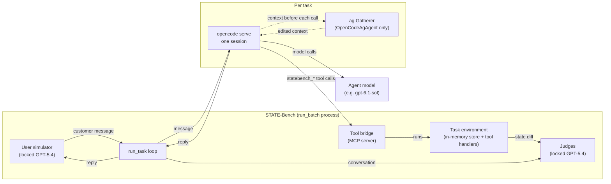

# Run Benchmark: Main Track

Use the **Main Track** to evaluate an agent or model on STATE-Bench's provided enterprise benchmark tasks. This is the default benchmark path.

If you want to benchmark agentic memory, skills, or prompt optimization, use the [Agent Learning Track](AGENT_LEARNING_TRACK.md) instead.

## 1. Install

STATE-Bench supports Python 3.12+ and uses [uv](https://docs.astral.sh/uv/). From a fresh checkout, sync dependencies and create your local environment file:

```bash
uv sync
cp .env.example .env
```

STATE-Bench makes LLM calls in three places:

- the locked user simulator,
- the locked judge,
- the agent under test.

The simulator and judge are fixed by the benchmark protocol. Your agent model is configurable.

## 2. Configure Clients

### Locked simulator and judge

Every official run requires the protocol-locked GPT-5.4 evaluation client. Configure it first:

- [Locked Evaluation Client](setup/eval-client.md)

### Agent under test

If you are evaluating an Azure AI Foundry model or OpenAI model with standard tool calling, use the built-in `StateBenchAgent` client:

- [Built-in StateBenchAgent Client](agents/builtin.md) (no code change needed; only configure env variables)

If you are evaluating models from a different provider or want to write a custom tool-calling agent, follow the instructions to extend the base classes:

- [Custom Client + Agent](USE_CUSTOM_CLIENT.md)

After you build the custom harness, come back to this guide and pass `--agent-class` and `--agent-client-class` in the run command below.

## 3. Run Tasks

Run one domain at a time:

```bash
uv run python -m state_bench.scripts.run_batch \
  --domain <domain> \
  --agent-model-name <model-name> \
  --num-runs 5 \
  --num-workers <parallel-workers> \
  --output-dir outputs/<domain>/
```

If your agent model uses a reportable reasoning level, add:

```bash
  --agent-model-reasoning-level <reasoning-level>
```

For a custom client + agent, add:

```bash
  --agent-class <YourAgent> \
  --agent-client-class <YourClient>
```

Use these values:

| Argument | Value |
| --- | --- |
| `--domain` | Required. `travel`, `customer_support`, or `shopping_assistant` |
| `--agent-model-name` | The model name to report in trajectories and metrics, such as `gpt-5.1` or `claude-sonnet-4.5` |
| `--agent-model-reasoning-level` | Optional reasoning level, such as `low`, `medium`, or `high`; omit if not applicable |
| `--num-runs` | `5` for official submissions |
| `--num-workers` | Parallel task workers; tune for your provider rate limits |
| `--output-dir` | `outputs/<domain>/` for the standard layout |

`run_batch` writes scored trajectories under:

```text
outputs/<domain>/run1/<task_id>.json
outputs/<domain>/run2/<task_id>.json
...
outputs/<domain>/run5/<task_id>.json
```

For the full CLI reference and worker guidance, see [run_batch](eval/run-batch.md).

## 4. Report Cost Per Task

Cost reporting is optional but strongly encouraged. Custom agents should compute provider-specific cost themselves and call `self.add_cost_usd(...)`; STATE-Bench aggregates the reported dollars without interpreting token buckets. Details: [Reporting Avg. Cost Per Task](eval/cost-reporting.md).

## 5. Compute Metrics

After a domain finishes, produce its standardized metrics file:

```bash
uv run python -m state_bench.scripts.compute_metrics \
  --domain <domain> \
  --results-dir outputs/<domain>/ \
  --num-runs 5 \
  --output-dir outputs/<domain>/
```

Metrics default to the protocol test split and fail if any expected test task is missing or unscored. Details: [Compute Metrics](eval/compute-metrics.md).

Repeat the run and metrics steps for `travel`, `customer_support`, and `shopping_assistant` for a complete submission.

## 6. Submit

Package the scored trajectories and metrics for each completed domain, then open a submission issue. Details: [Submit Results](SUBMIT.md).

## 7. Harness Agents: OpenCode and Actor-Gatherer

Besides the built-in `StateBenchAgent`, this repository ships agents under `agents/` that run the benchmark through a real agent harness, [OpenCode](https://opencode.ai), and through [Actor-Gatherer](../../actor-gatherer) (ag), a context manager that edits what the model sees before every model call. They use the same simulator, judges, tools, and tasks as every other run, so they are ordinary custom agents under the protocol.

### The agents

| `--agent-class` | Harness | ag | File |
| --- | --- | --- | --- |
| *(default)* `StateBenchAgent` | none: STATE-Bench calls the model directly | no | `state_bench/agents/state_bench.py` |
| `AgAgent` | none | yes, through ag's Codex adaptor | `agents/ag_agent.py` |
| `OpenCodeAgent` | OpenCode | no | `agents/opencode_agent.py` |
| `OpenCodeAgAgent` | OpenCode | yes, through ag's OpenCode plugin | `agents/opencode_agent.py` |

`OpenCodeAgent` and `OpenCodeAgAgent` share all of their code. The only difference is that the second launches OpenCode through ag, so comparing the two isolates ag's effect on a harness-equipped agent.

### How it fits together



Each task run goes like this:

1. **Start.** On the first customer message the agent starts one `opencode serve` in an empty temporary folder and opens one session. `OpenCodeAgAgent` starts it as `python -m ag.cli --gatherer statebench-oc-<id> opencode serve`, so ag's plugin is loaded and the task gets its own new gatherer.
2. **Lock-down.** OpenCode is configured, through `OPENCODE_CONFIG_CONTENT`, with one agent whose prompt is the domain's system prompt and whose only tools are the domain tools. Its built-in tools (bash, file read and edit, web fetch and others) are switched off.
3. **Tools.** The tool bridge is a small MCP server inside the `run_batch` process. It lists the domain's tools to OpenCode, which shows them as `statebench_<tool>`. Each call runs through STATE-Bench's own tool handler for that task, so it changes the task's environment and is recorded in the trajectory exactly like a call from the built-in agent.
4. **Turns.** Each customer message is sent to the session. OpenCode runs as many model calls and tool calls as it needs, and everything the agent wrote during the turn is returned as its reply. The session keeps the conversation, so only the new message is sent each turn.
5. **ag (OpenCodeAgAgent only).** Before every model call, ag's plugin hands the conversation to the Gatherer, which can summarize, trim, or add to it. The model sees ag's version. OpenCode's own automatic compaction is switched off so that condensing the history is ag's job.
6. **End.** The trajectory records token usage and the cost OpenCode reports, plus an `opencode` entry with the model, reasoning level, whether ag was on, and the gatherer name. OpenCode (and ag) are then stopped and the temporary folder is removed.

`AgAgent` is the harness-free counterpart. It keeps STATE-Bench's own turn loop, which executes the tools, and passes the conversation through ag before each model call. Because ag must see the whole conversation, it resends the full history every call instead of chaining with `previous_response_id` the way `StateBenchAgent` does.

### Setup

1. Install OpenCode and check it runs:

   ```bash
   npm install -g opencode-ai
   opencode --version
   ```

   If `opencode --version` fails on Linux or macOS, use the official installer (`curl -fsSL https://opencode.ai/install | bash`). If OpenCode is not on `PATH`, set `OPENCODE_BIN` to the binary.

2. For the ag agents, install Actor-Gatherer into the same environment (for example `uv pip install -e ../actor-gatherer`). Choose the Gatherer's model in `~/.ag/config.toml` (`[policies.llm] model = ...`) and set that provider's key, such as `GEMINI_API_KEY`.

3. Configure the agent model as for the built-in client: `STATE_BENCH_AGENT_API_KEY` in `.env`. The OpenCode agents pass it to OpenCode as `OPENAI_API_KEY`, and use the model given by `--agent-model-name`, which must be an OpenAI model OpenCode knows (`opencode models openai`).

### Run

```bash
uv run python -m state_bench.scripts.run_batch \
  --domain <domain> \
  --agent-class OpenCodeAgent \
  --agent-provider openai \
  --agent-model-name gpt-6.1-sol \
  --agent-model-reasoning-level medium \
  --num-runs 5 \
  --num-workers <parallel-workers> \
  --output-dir outputs/opencode/<domain>/
```

Use `--agent-class OpenCodeAgAgent` and a separate output folder, such as `outputs/opencode_ag/<domain>/`, for the ag run. Compute metrics for each folder as in step 5.

### Comparing with and without ag

For a fair comparison, keep everything but the agent class identical: the same task split, `--num-runs`, model, reasoning level, workers, and ag configuration. Run a small pilot first, such as one run of a few test tasks per domain, to check rate limits and timing. Then read the results as follows:

- **`OpenCodeAgAgent` vs `OpenCodeAgent`**: ag's effect on a harness-equipped agent. This is the main comparison.
- **`OpenCodeAgent` vs `StateBenchAgent`**: what the harness alone changes, and a link to other submissions' numbers.
- **`AgAgent` vs `StateBenchAgent`**: ag without a harness. This also includes the change from chained to resent conversation history, so it does not isolate ag on its own.

### Notes

- **Windows encoding.** On Windows, set `PYTHONUTF8=1` for every run. `run_batch` saves trajectories in the system's default encoding, which on Windows is cp1252, so a reply containing a character such as "→" fails to save and the task is counted as an error. Linux and macOS already default to UTF-8.
- **ag builds.** ag builds context only once a conversation reaches its `min_context_tokens` (15,000 by default). Most STATE-Bench conversations are shorter, so with default settings ag mostly passes the conversation through. Set `build_every_request = true` in ag's policy options if it should build on every call.
- **ag's guide message.** ag adds its gatherer guide ahead of the conversation, and the agent may treat it as part of the customer's first message. Setting `gatherer_guide = ""` removes it.
- **Time and cost.** In a one-task check, a task with judging took about 1 minute with `OpenCodeAgent` and about 2 minutes with `OpenCodeAgAgent`. The Gatherer's own model calls are not included in the reported cost.
- **Leftover gatherers.** Every ag task run leaves a gatherer under `~/.ag/gatherers/` (`statebench-*`, `statebench-oc-*`). They can be deleted after a run.

## Official Run Settings

For protocol-compliant submissions:

- use the locked GPT-5.4 simulator and judge client,
- do not edit simulator prompts, judge prompts, domain tools, task files, environment files, or protocol files,
- run `--num-runs 5`,
- compute metrics with the same number of runs,
- include `metrics.json` and scored trajectories for each submitted domain.
